# Digital Forensics & Cyber Security — Day 1 Complete Study Guide & Assessment
**Programme:** Digital Forensics and Cyber Security Bootcamp, Atomcamp  
**Instructor:** Waseem Abbas Khan  
**Date:** 24 October 2026  
**Candidate:** Islam Gul  
**Repository:** https://github.com/islamgul1332-IT/Digital-Forensics-and-Cybersecurity-Day-1-work-and-assessment

---

## Table of Contents
1. [Foundations of Information Security](#1-foundations-of-information-security)
2. [The Cyber Kill Chain](#2-the-cyber-kill-chain)
3. [Virtualisation and Lab Environment](#3-virtualisation-and-lab-environment)
4. [Linux Fundamentals](#4-linux-fundamentals)
5. [Files, Permissions and Users](#5-files-permissions-and-users)
6. [Package Management and Services](#6-package-management-and-services)
7. [Processes and Logs](#7-processes-and-logs)
8. [Networking Essentials](#8-networking-essentials)
9. [Cryptography: Encoding, Ciphers and Encryption](#9-cryptography-encoding-ciphers-and-encryption)
10. [Security Vocabulary](#10-security-vocabulary)
11. [Shell Essentials](#11-shell-essentials)
12. [Practical Tasks with Solutions](#12-practical-tasks-with-solutions)
13. [Evidence Index](#13-evidence-index)
14. [References](#14-references)

---

# 1. Foundations of Information Security

## 1.1 The CIA Triad

Information security exists to protect three fundamental properties of information and systems. Every security control you will ever implement protects one or more of these.

| Property | Simple Meaning | Real-World Breach Example | Protective Controls |
|----------|---------------|---------------------------|---------------------|
| **Confidentiality** | Only authorised people can access the information | **Equifax 2017**: Unpatched Apache Struts vulnerability on a public portal allowed attackers to read approximately 147 million people's personal records | Patching, network segmentation, encryption at rest and in transit |
| **Integrity** | Information has not been altered without authorisation | **Stuxnet 2010**: PLC commands were manipulated to destroy centrifuges while operators saw completely normal readings on their screens | Digital signatures, cryptographic hashes, out-of-band verification |
| **Availability** | Systems and data are accessible when needed | **Colonial Pipeline 2021**: Ransomware forced the operator to shut down the pipeline itself, causing fuel shortages across the US East Coast | Redundancy, tested backups, monitored remote access |

**Key Insight:** In all three cases, the control that would have prevented the breach was already known, available, and relatively cheap. The failure was organisational, not technical. This principle will guide every recommendation you write in this course.

## 1.2 Man-in-the-Middle (MITM) Attacks

A MITM attack occurs when an attacker positions themselves between the client and server, relaying the conversation while secretly reading or modifying it.

```
CLIENT  ---->  ATTACKER (MITM)  ---->  SERVER
CLIENT  <----  ATTACKER (MITM)  <----  SERVER
```

**How MITM becomes possible:**
- Unencrypted protocols (HTTP, FTP, Telnet)
- Network position control (rogue Wi-Fi hotspots, ARP spoofing, DNS poisoning)
- TLS interception where the user accepts a fake certificate

**MITM Variants and Defences:**

| Variant | How the Attacker Wins | How the Defender Breaks It |
|---------|----------------------|---------------------------|
| **Rogue Wi-Fi Hotspot** | Victims connect to attacker's access point; attacker sees all traffic | TLS certificate validation; user training; never trust open Wi-Fi |
| **ARP Spoofing on LAN** | Attacker answers ARP requests for the gateway, relaying all LAN traffic | Dynamic ARP Inspection (DAI); port security on switches |
| **TLS Interception with Fake CA** | User installs attacker's CA certificate or clicks through browser warning | Certificate pinning in applications; HSTS preload lists; warning reporting |
| **DNS Poisoning** | DNS answers point victim to attacker's server instead of the real one | DNSSEC where available; DNS over HTTPS (DoH); DNS monitoring |

## 1.3 Hash Functions — One-Way by Design

A hash function takes any input (a file, a password, a message) and produces a fixed-length output called a digest or hash. Three properties define a secure hash:

1. **Deterministic:** The same input always produces the exact same hash
2. **One-way:** You cannot reverse the process — you cannot go from hash back to input
3. **Collision-resistant:** Two different inputs must not produce the same hash (this failure ended MD5 and SHA-1 for security purposes)

**Critical TRAP:** A hash is NOT encryption. You cannot "decrypt" a hash. When attackers "crack" passwords, they guess candidate passwords, hash each guess, and compare the result to the stolen hash. This is brute-force comparison, not decryption.

**Practical commands:**
```bash
echo -n 'hello' | sha256sum
echo -n 'hello' | md5sum
echo -n 'Hello' | sha256sum
```


**Output:**

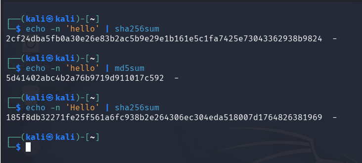

**Where you use this in forensics:** Verifying that an evidence image was not altered during acquisition (weekend 8), and confirming a downloaded file matches its published hash.

## 1.4 Denial of Service (DoS) and Distributed DoS (DDoS)

DoS attacks target **Availability** by making a service unusable for legitimate users. DDoS uses many distributed sources, making simple blocking ineffective.

| Type | Example | Signature | Defence |
|------|---------|-----------|---------|
| **Volumetric** | Bandwidth flood (UDP amplification) | Internet uplink completely saturated | Traffic scrubbing services, upstream filtering by ISP |
| **Protocol** | SYN flood | Server's connection table exhausted with half-open connections | SYN cookies, rate limiting, firewall tuning |
| **Application Layer** | HTTP request flood against an expensive search page | CPU/memory exhausted on specific application endpoints | Caching, rate limits, CAPTCHA, Web Application Firewall (WAF) |

**Legal warning:** DoS against your own lab VM is a legitimate learning exercise. DoS against any system you do not own is a criminal act in virtually every jurisdiction.

---

# 2. The Cyber Kill Chain

The Cyber Kill Chain, developed by Lockheed Martin, describes the seven stages of a targeted attack. The value is not memorising names — it is understanding what the defender can do at each stage. Attackers must succeed at every stage; defenders only need to break one.

| Stage | Attacker's Actions | Defender's Actions |
|-------|-------------------|-------------------|
| **1. Reconnaissance** | Studies the target: public data, DNS records, exposed services, employee names on LinkedIn | Reduce public exposure; monitor certificate transparency logs; watch for lookalike domain registrations |
| **2. Weaponisation** | Builds the tool: malicious document, exploit, phishing page | Threat intelligence feeds; block known malicious signatures |
| **3. Delivery** | Sends the weapon: email attachment, USB drop, web link, compromised website | Email filtering; DMARC/SPF/DKIM; user reporting; web filtering |
| **4. Exploitation** | Triggers the code or steals the credential | Patching; Multi-Factor Authentication (MFA); memory protection; least privilege |
| **5. Installation** | Establishes persistence: new service, startup item, scheduled task | EDR (Endpoint Detection & Response); application whitelisting; monitoring persistence locations |
| **6. Command & Control (C2)** | Calls out to attacker infrastructure over HTTPS or DNS for orders | Egress filtering; DNS monitoring; beacon detection; anomaly detection |
| **7. Actions on Objectives** | Steals data, encrypts files, damages operations | Backups; Data Loss Prevention (DLP); immutable logging |

**Worked Example — One Attack Through Seven Stages:**
A finance employee receives an email with an invoice attachment (Delivery). Opening it triggers a malicious macro (Exploitation) which writes a scheduled task (Installation) and beacons to a new domain over HTTPS (C2) so the attacker can read the entire mail archive (Actions on Objectives).

**MITRE ATT&CK Relationship:** The Kill Chain tells you the *phase* of an attack. ATT&CK provides the specific *technique* (e.g., T1059 for command scripting) so analysts worldwide describe the same behaviour identically. Kill Chain is the story; ATT&CK is the dictionary.

---

# 3. Virtualisation and Lab Environment

## 3.1 Core Terminology

| Term | Meaning |
|------|---------|
| **Host** | Your real physical computer (e.g., your Windows laptop) |
| **Guest** | The virtual machine running on the host (e.g., Kali Linux) |
| **Hypervisor** | The software layer that runs guests: VMware Workstation, VirtualBox, Hyper-V |
| **Image** | A disk file you can copy, snapshot and destroy: `.iso` (installer), `.vmdk`/`.vdi` (virtual disk) |
| **Snapshot** | A saved state you can return to after breaking something |

## 3.2 Why We Work in Virtual Machines

1. **Recoverability:** An attacked VM can be reverted to a snapshot in seconds. A real machine cannot.
2. **Containment:** Malware never touches the host operating system.
3. **Multiple Roles:** Two or three machines on one laptop, attacking and defending each other.
4. **Reproducibility:** Copying a VM file is cloning a computer — essential for forensic practice.

## 3.3 Network Modes — The Most Important Concept

| Mode | What It Does | When to Use | Risk |
|------|-------------|-------------|------|
| **Bridge** | VM becomes a real machine on your home network with its own LAN address | Downloading updates; reaching a lab target on your LAN | VM is visible to every device on your network |
| **NAT** | Virtual switch gives internet access; host acts as router; other LAN devices cannot reach the VM | Normal day-to-day work in Kali | Cannot be reached from other machines (good for safety) |
| **Host-only** | Virtual switch with no internet at all | Malware analysis; deliberate isolation tests | No updates, no internet |
| **Internal Network** | A private switch shared only by named VMs | Multi-machine labs and malware weekends | Invisible unless you name it in each VM |

**Critical for Malware:** You will move to host-only or internal network and **prove** isolation rather than assume it. 

## 3.4 Lab Layout
**Output:**

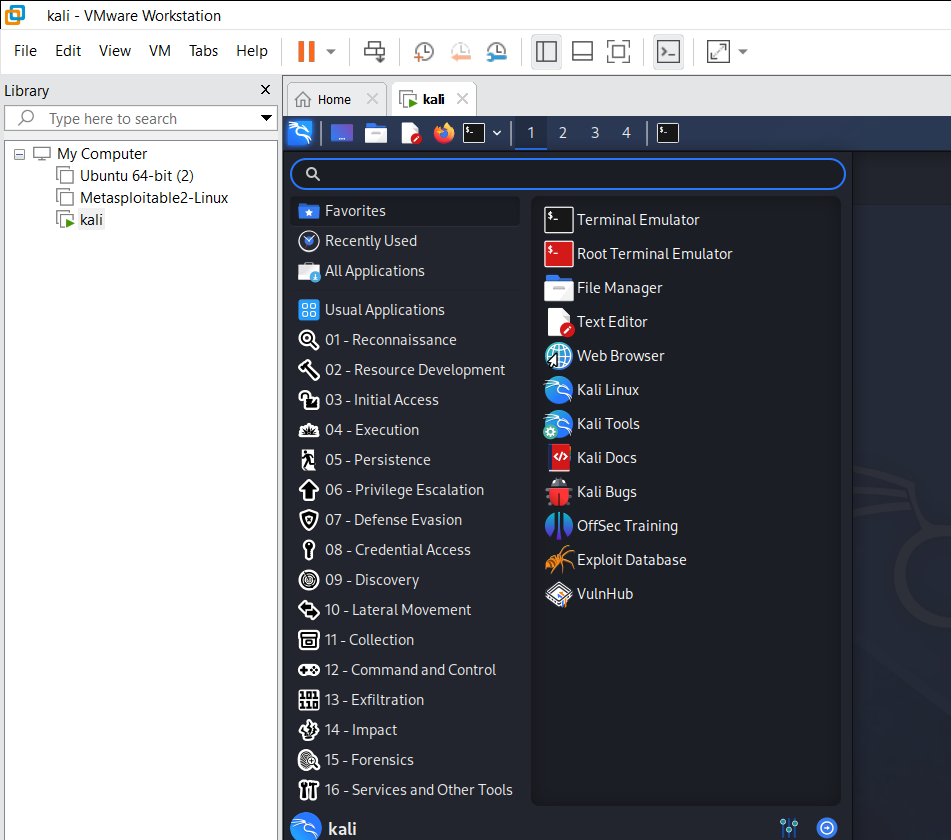

**Resources:**
- Kali VM images: kali.org/get-kali → Kali virtual machines
- Ubuntu Server: osboxes.org → Ubuntu Server
- Windows ISO (for later): Microsoft evaluation downloads

---

# 4. Linux Fundamentals

## 4.1 Distribution Families

| Family | Package Tool | Examples | Why It Matters |
|--------|-------------|----------|----------------|
| **Debian** | `apt` / `.deb` | Debian, Ubuntu, Kali, Parrot | Your entire lab is Debian-family — you use `apt` |
| **Red Hat** | `dnf` / `yum` / `.rpm` | RHEL, CentOS Stream, Fedora | Enterprise servers at work; commands differ |
| **Arch** | `pacman` | Arch, BlackArch | Rolling release; BlackArch is security-focused |

**Learning point:** `apt` is not "Linux" — it is the Debian-family package manager. On a Red Hat server, the same task is `dnf install`. Never assume the command transfers.

## 4.2 Reading the Prompt

```
kali@ALIENWARE:~$
```

| Symbol | Meaning |
|--------|---------|
| `kali` | The user you logged in as |
| `@Kali` | The hostname of the machine |
| `~` | Your home directory, shorthand for `/home/kali` |
| `$` | You are a normal user |
| `#` | You are root — every command runs with full power and no undo |


## 4.3 su, sudo, and Proper Escalation

| Command | What It Really Does | Which Password | When to Use |
|---------|-------------------|----------------|-------------|
| `su` | Switch user; with no argument switches to root | Target user's password (root) | When you know root password |
| `su root` | Same, explicitly to root | Root password | Same as above |
| `sudo -i` | Start a login shell as root through sudo | **YOUR password** | The normal way on Kali and Ubuntu |
| `sudo` | Run one command as root | **YOUR password** | The safest and most common form |
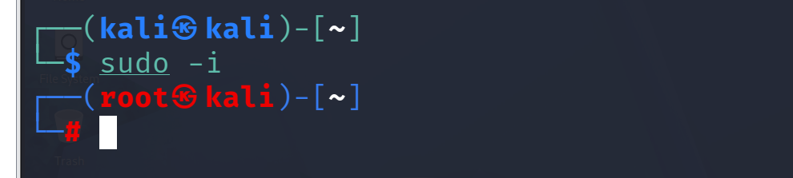

**CORRECTION from live session:** `sudo` asks for YOUR password, not root's. That is the whole point — no one needs the root password. The condition is not "user must be superuser"; the user must be in the `sudo` group (listed in `/etc/sudoers`).

**Verification commands:**
```bash
id
sudo -l
groups
exit  # leave the root shell when done
```
Output

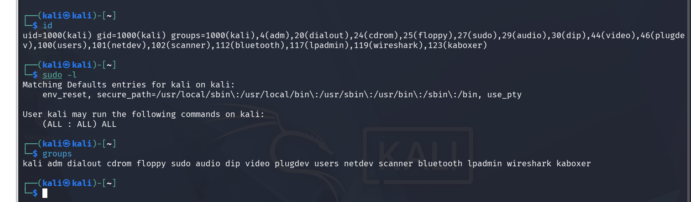
## 4.4 Privilege Escalation — The Concept

Privilege escalation means going from a low-privilege account to a higher one. It is the goal of most real attacks after initial access.

| Type | Example | Where You Meet It |
|------|---------|-------------------|
| **Horizontal** | Getting another normal user's account | Credential theft between colleagues |
| **Vertical** | Getting root or administrator | SUID binaries, sudo misconfiguration, kernel exploits |
| **Escape** | Leaving a container or restricted shell | Later cloud and container sessions |

---

# 5. Files, Permissions and Users

## 5.1 Key Filesystem Locations

| Path | What It Is | Investigation Value |
|------|-----------|---------------------|
| `/` | The single root of everything | Everything else hangs from here |
| `/home` | Home directories for normal users | `/home/kali` holds user's files, history, keys |
| `/root` | Root's own home | Did the attacker escalate and leave artefacts here? |
| `/etc` | Configuration files | Who can login, what services run |
| `/var/log` | Log files | Who authenticated, what failed, when |
| `/tmp` | World-writable scratch space | Malware loves `/tmp` |
| `/var/www/html` | Default Apache document root | What the web server is actually serving |

## 5.2 Reading Permissions

```
-rwxr-xr-- 1 kali kali 1234 Oct 24 15:20 public.txt
```

Breaking this down:
- First character `-` = file type (`-` file, `d` directory, `l` link)
- Next three `rwx` = owner permissions (read, write, execute)
- Next three `r-x` = group permissions (read, execute)
- Last three `r--` = others permissions (read only)

| Letter | On a File | On a Directory |
|--------|-----------|----------------|
| `r` (read) | See the contents | List the names inside |
| `w` (write) | Change the contents | Create, rename or delete entries |
| `x` (execute) | Run it as a program | Enter it with `cd` |

## 5.3 Octal Notation

Numbers are the same three bits in decimal: **r=4, w=2, x=1**, added per group.

| Mode | Symbolic | Meaning |
|------|----------|---------|
| `777` | `rwxrwxrwx` | Everyone can do everything. Almost always wrong. |
| `755` | `rwxr-xr-x` | Owner full, everyone else read+enter. Normal for directories and executables. |
| `644` | `rw-r--r--` | Owner read/write, everyone else read. Normal for files. |
| `600` | `rw-------` | Only the owner. Correct mode for private keys. |
| `4755` | `rwsr-xr-x` | 755 plus SUID: runs with owner's privileges. You will abuse these later. |
| `000` | `----------` | Nobody has any permission, including the owner. |

## 5.4 chmod — Changing Permissions

**Symbolic style** (who + action + what):
```bash
chmod o-r public.txt      # remove read from others
chmod u+x script.sh       # add execute for owner
chmod g-w shared.txt      # remove write from group
chmod o=r public.txt      # set others to read-only
chmod a+r file.txt        # add read for all
```

**Octal style** (numbers):
```bash
chmod 640 report.txt      # rw-r----- 
chmod 755 script.sh       # rwxr-xr-x
chmod 600 private_key.pem # rw-------
```
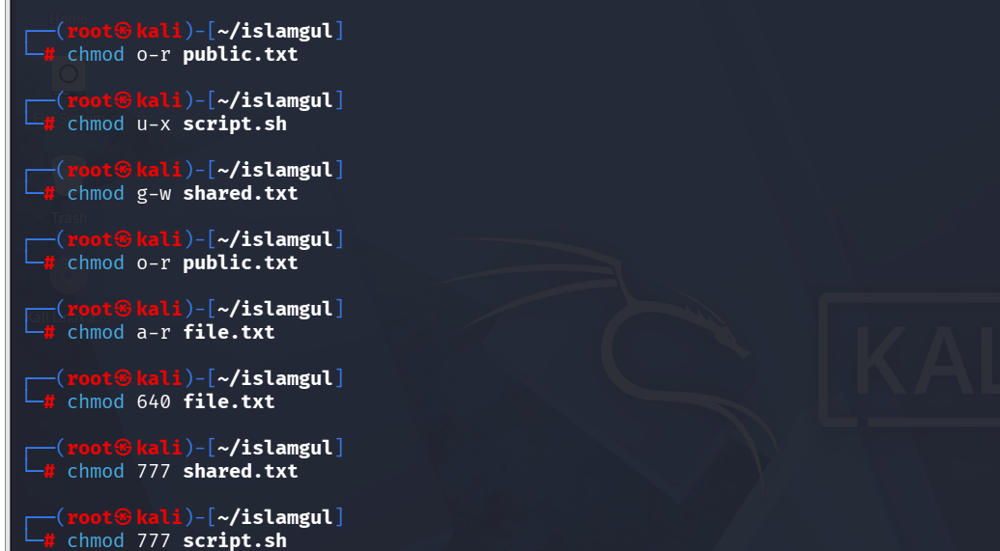

**CRITICAL TRAP:** Deleting a file depends on the **directory's** write permission, not the file's permission. A file with `000` permissions can still be deleted by anyone who can write to its directory. This is why world-writable directories are dangerous even when every file inside them is locked down.

## 5.5 Users and Groups

```bash
sudo adduser zain          # interactive: creates user, group, home, asks password
sudo useradd -m zain       # low-level: creates account; YOU must set password and shell
id zain                    # show user ID and groups
cat /etc/passwd | grep zain
groups zain
```
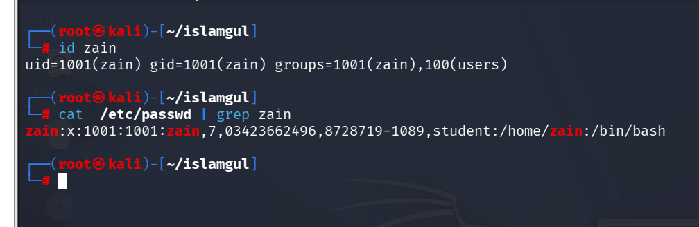
**Fields in `/etc/passwd`:**
```
zain:x:1001:1001:,,,:/home/zain:/bin/bash
```
- Username: `zain`
- Password: `x` (placeholder — real hash lives in `/etc/shadow`)
- UID: `1001`
- GID: `1001`
- Home directory: `/home/zain`
- Login shell: `/bin/bash`

**Warning:** `adduser` is the friendly Debian wrapper. `useradd` is raw — if you forget `-m` (home) and the shell, you get an account that cannot log in. This is a common real-world finding.

---

# 6. Package Management and Services

## 6.1 apt — Package Management

```bash
sudo apt update          # refresh the package list (what is available)
sudo apt upgrade -y      # install newer versions of what you already have
sudo apt install apache2 # add a package
sudo apt remove apache2  # remove package, keep config
sudo apt search wireshark  # search for packages
```

| Command | What It Touches | Common Mistake |
|---------|-----------------|----------------|
| `apt update` | Package index only | Thinking it upgrades software — it does not |
| `apt upgrade` | Installed packages | Running update but skipping upgrade, then wondering why versions are old |
| `apt install` | Adds a package | Running install without update first, so the index is stale |
| `apt remove` | Removes package, keeps config | Expecting config to disappear; use `purge` for that |

By Running the command sudo apt install apache2 its is installed now and is its is shown through the  command apache2 v
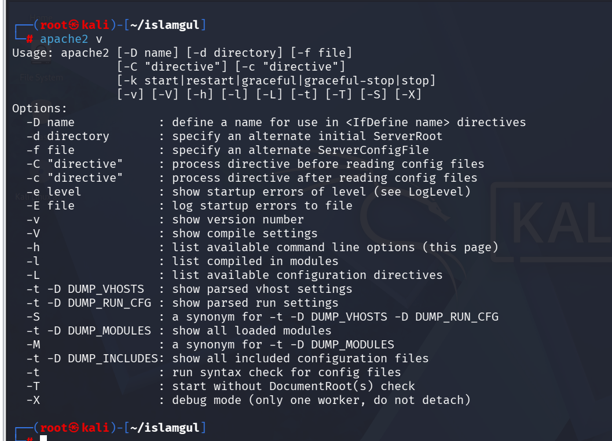

## 6.2 systemctl — Controlling Services

```bash
sudo systemctl start apache2    # start now
sudo systemctl stop apache2     # stop now
sudo systemctl restart apache2  # stop then start (use after config change)
sudo systemctl status apache2   # show state plus last log lines
sudo systemctl enable apache2   # start automatically at boot
sudo systemctl disable apache2  # do not start at boot
sudo systemctl is-active apache2 # one-word answer, useful in scripts
```
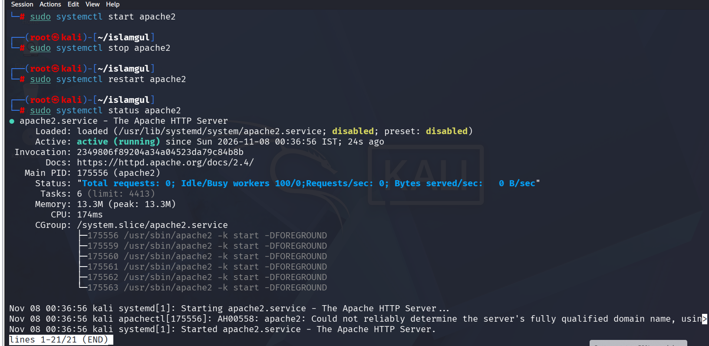
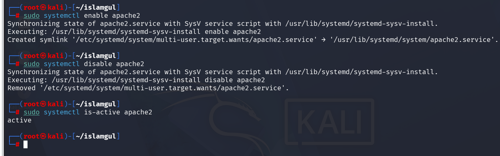

## 6.3 The Document Root Lesson

Apache serves files from `/var/www/html` by default. The Day 1 lab sequence:
```bash
cd /var/www/html
ls -l
sudo rm *                    # remove default page (TRAP: rm * is permanent)
sudo nano public.txt         # create your own file
sudo chmod o-r public.txt    # now others cannot read it
sudo systemctl stop apache2
sudo systemctl start apache2
```
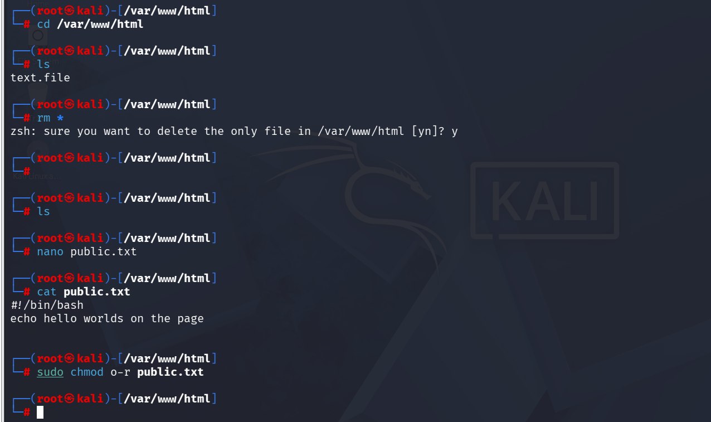
**HTTP Status Codes — The Five Families:**

| Range | Family | Key Codes | Investigator's View |
|-------|--------|-----------|-------------------|
| 1xx | Informational | 100 Continue, 101 Switching Protocols | Rare in investigations; protocol upgrades show here |
| 2xx | Success | 200 OK, 201 Created, 204 No Content | Request worked — a 200 on `/admin` is worth asking about |
| 3xx | Redirection | 301 Moved Permanently, 302 Found, 304 Not Modified | Login redirects; evidence of probing |
| 4xx | Client Error | 400, 401, 403 Forbidden, 404 Not Found, 429 Too Many Requests | 403/404 floods in access.log are the classic scanning signature |
| 5xx | Server Error | 500 Internal Server Error, 502 Bad Gateway, 503 Service Unavailable | A 500 right after odd input often means the application choked on it |

**Why 403 Matters:** A 403 after `chmod o-r` is not a bug — it is Apache correctly refusing to read a file its user cannot read. When you break a web application on purpose, 403 is information (something exists and is protected); 404 is silence. Learning to read the difference is half of web forensics.

---

# 7. Processes and Logs

## 7.1 Process Management

```bash
top                 # live view; q to quit
ps                  # your processes, current terminal
ps -A               # every process on the system
ps aux              # every process, with user and resource usage
ps -A | grep firefox # filter for one program
kill 23269          # polite termination (SIGTERM)
kill -9 23269       # force (SIGKILL) — no cleanup, no chance to save
```
Output of top command 
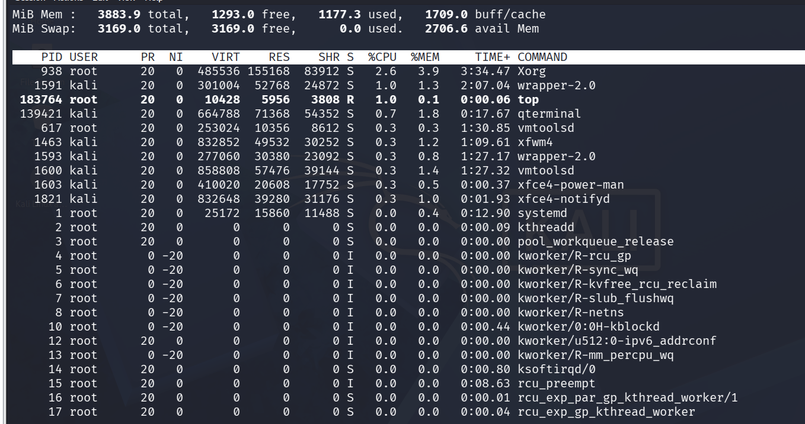
output of ps and ps -A command 
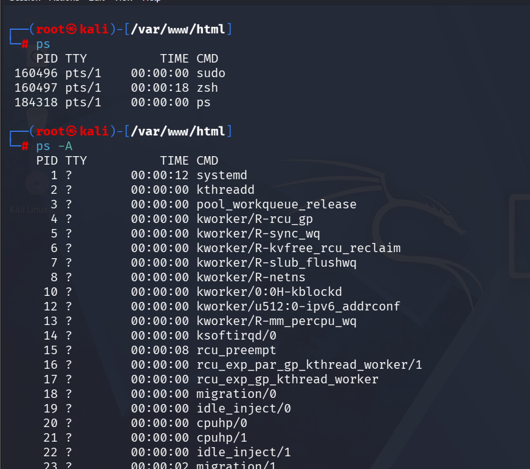
output of ps aux command 
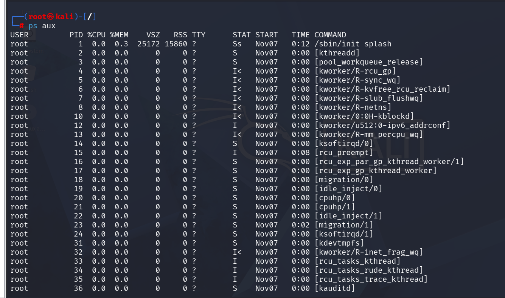
Serching a process through grep command and then stoping it through kill command 
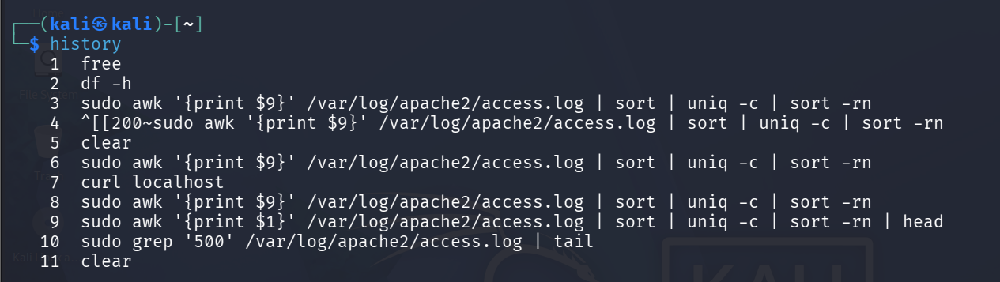
| Signal | Number | Meaning | Use When |
|--------|--------|---------|----------|
| SIGTERM | 15 | Ask program to stop and tidy up | First attempt, always |
| SIGKILL | 9 | Kill immediately, cannot be caught | Process ignores SIGTERM |
| SIGHUP | 1 | Often used to reload configuration | After editing a service config |

**Windows equivalents:** `tasklist` lists processes; `taskkill /F /PID 35432` force-kills one.

## 7.2 Apache Access Log Format

```
127.0.0.1 - - [24/Oct/2026:14:52:01 +0500] "GET /public.txt HTTP/1.1" 200 12 "-" "Mozilla/5.0"
```

| Field | Meaning | Investigation Value |
|-------|---------|---------------------|
| `127.0.0.1` | Client address | Who asked; repeated odd sources mean scanning |
| `- -` | Identity and username (usually empty) | Unreliable, do not rely on them |
| `[24/Oct/2026:14:52:01 +0500]` | Timestamp with offset | The anchor for any timeline |
| `"GET /public.txt HTTP/1.1"` | Method, path, protocol | What they tried to reach |
| `200` | Status code | Success or failure of the attempt |
| `12` | Bytes returned | Large responses from odd paths are worth a look |
| `"Mozilla/5.0"` | User agent | Tools often lie, but a scanner's agent leaks it |

**Log Analysis Commands:**
```bash
sudo awk '{print $9}' /var/log/apache2/access.log | sort | uniq -c | sort -rn  # status code counts
sudo grep -c '404' /var/log/apache2/access.log                                  # how many misses
sudo awk '{print $1}' /var/log/apache2/access.log | sort | uniq -c | sort -rn | head  # busiest clients
sudo grep '500' /var/log/apache2/access.log | tail                              # server errors
```
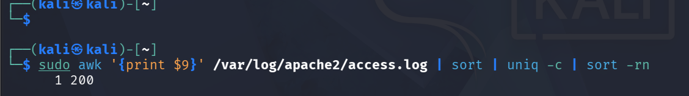

**Windows Side:** On Linux, authentication logs are `/var/log/auth.log` or `journalctl`. On Windows, it is the Security event log: Event ID 4624 (successful logon), 4625 (failed logon). Repeated 4625s followed by a 4624 for the same account is brute force that succeeded — the single most important pattern in entry-level SOC work.

## 7.3 Shell History as Evidence

```bash
history              # this session's commands
history 30           # last 30
cat ~/.zsh_history | tail -30   # Kali's default shell is zsh
cat ~/.bash_history | tail -30  # bash systems
```
output of history command
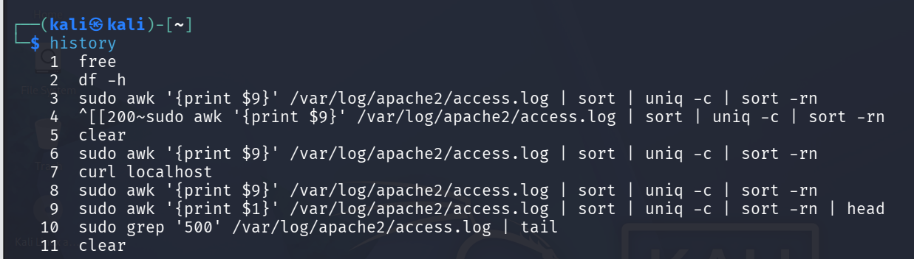

| Artefact | Where | What It Proves |
|----------|-------|--------------|
| Shell history | `~/.bash_history` or `~/.zsh_history` | Commands typed by that user (not by scripts) |
| Auth log | `/var/log/auth.log` or `journalctl` | Who logged in, from where, which method |
| Apache access log | `/var/log/apache2/access.log` | What was requested, by whom, with what result |
| Process table | `ps` / `top` / `/proc` | What is running right now |
| Timestamps on files | `ls -l` / `stat` | When something was created or modified |

---

# 8. Networking Essentials

## 8.1 IP Address Classes

| Class | First Octet | Private Range | Structure | Hosts per Network |
|-------|-------------|---------------|-----------|-------------------|
| A | 1–126 | 10.0.0.0 – 10.255.255.255 | N.H.H.H | 16,777,214 |
| B | 128–191 | 172.16.0.0 – 172.31.255.255 | N.N.H.H | 65,534 |
| C | 192–223 | 192.168.0.0 – 192.168.255.255 | N.N.N.H | 254 |
| IPv6 | — | fc00::/7 | 128 bits, written in hex groups | Effectively unlimited |

**Special Addresses:**
- `127.x.x.x` — loopback (this machine)
- `169.254.x.x` — link-local; if a computer has this, DHCP failed (classic first thing to check)
- `0.0.0.0` in a listening socket — means "every interface"

## 8.2 Common Ports

| Range | Name | Notes |
|-------|------|-------|
| 0–1023 | Well-known | Need root to bind on Linux |
| 1024–49151 | Registered | Databases and applications live here |
| 49152–65535 | Dynamic/ephemeral | The source port of your outbound connection |

| Port | Service | Port | Service |
|------|---------|------|---------|
| 21 | FTP | 53 | DNS (TCP and UDP) |
| 22 | SSH | 67/68 | DHCP server/client |
| 23 | Telnet (plaintext — never use) | 69 | TFTP |
| 25 | SMTP | 80 | HTTP |
| 123 | NTP | 1433 | MSSQL |
| 161/162 | SNMP | 443 | HTTPS |
| 514 | Syslog | 3306 | MySQL |

## 8.3 ping, TTL, and Estimating Distance

```bash
ping -c 4 google.com
ip a
traceroute google.com
```
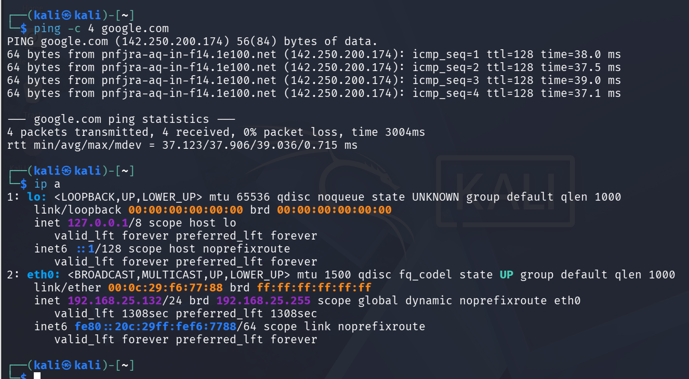
output of the traceroute google.com
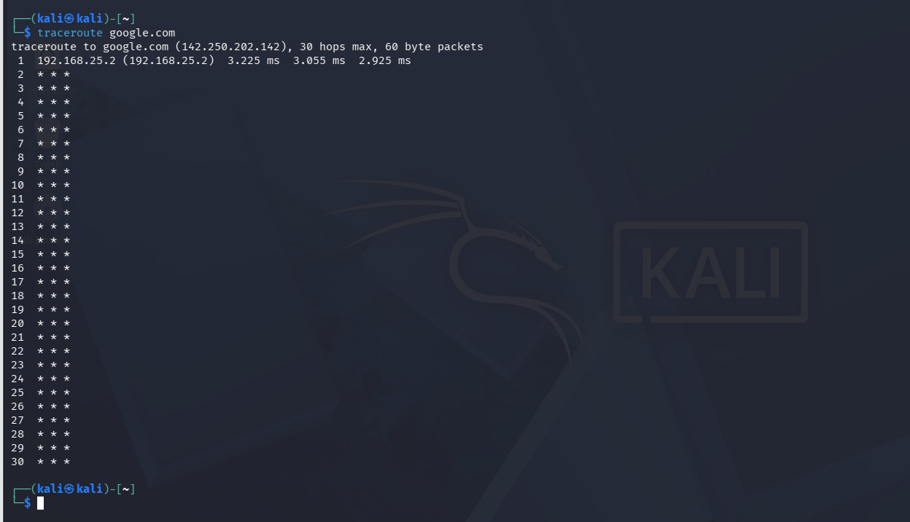
**How TTL Actually Works:**
- TTL is a hop counter; each router decrements it by one
- It starts at an OS default; you see what is left
- Typical starting values: Linux and most network devices = 64; Windows = 128; some devices = 255

**Reading TTL:**
- `ttl=115`: ≤128 and >64, so start was 128 → 128 − 115 = 13 hops
- `ttl=52`: ≤64, so start was 64 → 64 − 52 = 12 hops

**CORRECTION — READ THIS:** TTL is triage, not proof. In an investigation it is a hint that costs nothing to check; it is not evidence of the operating system. A firewall appliance rewriting TTL will make a Windows host look like Linux, and you will write a wrong finding if you forget this.

---

# 9. Cryptography: Encoding, Ciphers and Encryption

## 9.1 The Distinction That Matters

| Term | What It Does | Reversible Without a Key? | Example |
|------|-------------|---------------------------|---------|
| **Encoding** | Preserves data in a different format for transport | Yes — always | Base64, URL encoding |
| **Cipher (classical)** | Hides meaning with a scheme | Yes for modern attackers (Caesar takes seconds) | Caesar, Vigenère |
| **Hashing** | Produces a fixed-length fingerprint | No — one-way by design | SHA-256, MD5 |
| **Encryption** | Hides data behind a mathematical key | Only with the correct key | AES, RSA |
| **Steganography** | Hides the data's existence | With the right tool | Image LSB, audio |

## 9.2 Caesar Cipher — HACKER became KDFNHU

A Caesar cipher shifts every letter by a fixed amount. Day 1 demonstrated +3:

| Plain | H | A | C | K | E | R |
|-------|---|---|---|---|---|---|
| Shift +3 | K | D | F | N | H | U |

**Verification commands:**
```bash
python3 -c "s='HACKER';print(''.join(chr((ord(c)-65+3)%26+65)for c in s))"
python3 -c "s='KDFNHU';print(''.join(chr((ord(c)-65-3)%26+65)for c in s))"
```
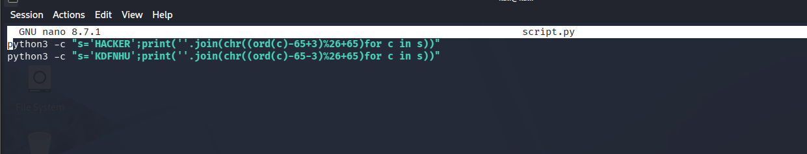
output 
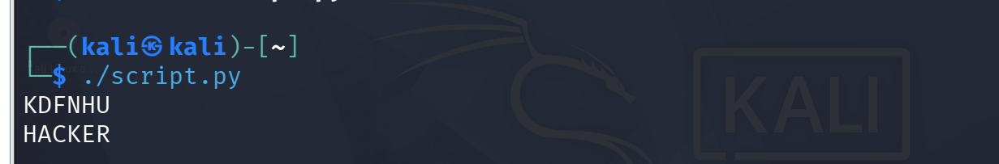
**Why it is useless as security:** Only 25 possible keys. A computer tries all instantly; a human can brute-force by eye. Its value today is teaching the concept of a key and an algorithm.

## 9.3 Base64 — Encoding, Not Encryption

```bash
echo -n 'hello world' | base64
echo 'hello world' | base64
echo 'aGVsbG8gd29ybGQ=' | base64 -d
```

**Output:**
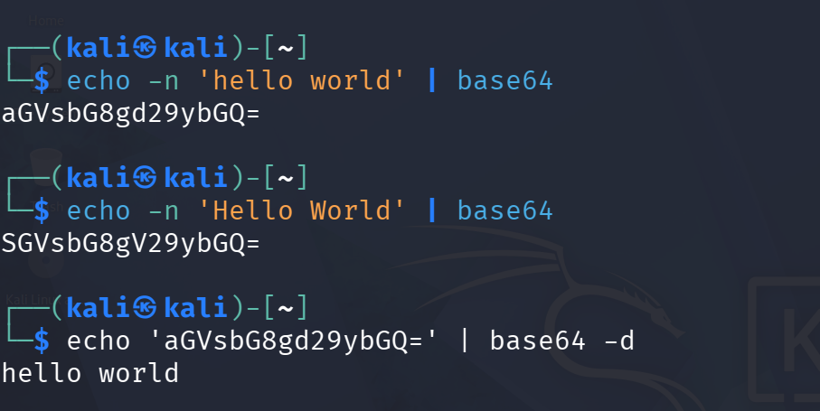

**THE TRAILING NEWLINE TRAP:** The trailing `K` is a newline character that `echo` added. Use `echo -n` (or `printf`) when you want to encode exactly what you typed. This off-by-one newline problem causes real authentication failures in scripts and real false findings in forensics.

Base64 exists because some channels only carry text. It is reversible by anyone, with no key. Finding Base64 in a payload tells you how it was transported, not that it was secret.

## 9.4 Symmetric Encryption with OpenSSL (AES)

```bash
mkdir cyber && cd cyber
nano secret.txt                    # type something, e.g., "my secret message"
openssl enc -aes-256-cbc -salt -in secret.txt -out secret.enc
ls -l secret.txt secret.enc
cat secret.enc                     # unreadable garbage
openssl enc -d -aes-256-cbc -in secret.enc -out decrypt.txt
cat decrypt.txt                    # your original text
```
encryption using SSL(AES)
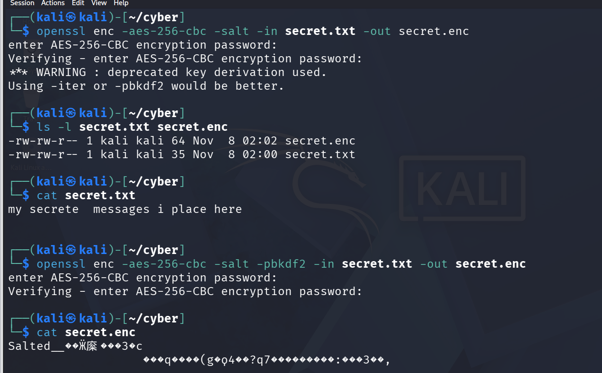


| Flag | Meaning |
|------|---------|
| `enc` | The symmetric cipher tool inside OpenSSL |
| `-aes-256-cbc` | AES with a 256-bit key in Cipher Block Chaining mode |
| `-salt` | Adds a random salt so the same password produces different ciphertext each time |
| `-in` / `-out` | Input and output files |
| `-d` | Decrypt instead of encrypt |

**UPGRADE YOUR COMMAND:** Add `-pbkdf2` — modern OpenSSL warns that the default key derivation is deprecated. Also, CBC does not detect tampering — flip a byte and you get silent garbage. For real work use an authenticated mode (GCM) through a library, because `openssl enc` does not support AEAD ciphers at all.

## 9.5 Looking Inside the File

```bash
xxd -l 16 secret.enc
file secret.enc
```

**Output:**
```
00000000: 5361 6c74 6564 5f5f a7a0ff99 589c686d  Salted__....X.hm
secret.enc: openssl enc'd data with salted password
```

`Salted__` is an 8-byte magic header that OpenSSL writes when `-salt` is used. It is not secret — it simply tells the decryption step which salt to use. In forensics, that header plus the `file` command is how you identify an unknown blob.

## 9.6 Asymmetric Encryption: RSA

```bash
openssl genrsa -out Private_Key.pem 4096
cat Private_Key.pem | head -3
openssl rsa -in Private_Key.pem -pubout -out Public_Key.pem
ls -l
openssl pkeyutl -encrypt -in secret.txt -out encrypted.rsa -pubin -inkey Public_Key.pem
openssl pkeyutl -decrypt -in encrypted.rsa -out decrypted.txt -inkey Private_Key.pem
cat decrypted.txt
```
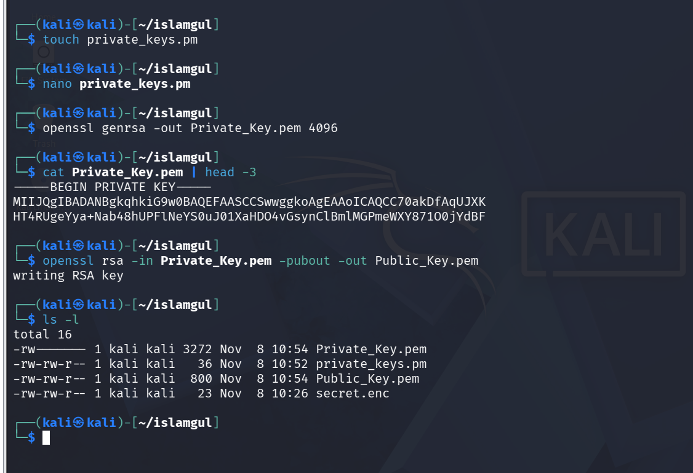
| Concept | Meaning in This Lab |
|---------|---------------------|
| **Public key** | Used to ENCRYPT. Safe to share. |
| **Private key** | Used to DECRYPT. Never share. Created with mode 600 for a reason. |
| **4096** | Key size in bits. Signature and ciphertext length follow the modulus. |
| **pkeyutl** | The generic public-key operation tool; encrypt and decrypt are separate `-in`/`-out` pairs |

**THE LIMIT YOU MUST KNOW:** RSA can only encrypt a small amount of data — roughly the key size minus padding. A 406-byte file fails with "data too large for key size." This is why real systems use hybrid encryption: RSA protects a random AES key, and AES encrypts the data. You will see this pattern again in TLS.

**Symmetric vs Asymmetric:**

| | Symmetric (AES) | Asymmetric (RSA) |
|---|---|---|
| Keys | One shared key | A key pair: public + private |
| Speed | Fast, used for bulk data | Slow, used for small data or key exchange |
| Problem it solves | Bulk encryption | The key distribution problem |
| In TLS | Encrypts the actual traffic | Authenticates the server and exchanges the session key |

---

# 10. Security Vocabulary

These five words appear in every report you will write. The definitions below are the ones to use.

| Term | Definition | Running Example |
|------|-----------|-----------------|
| **Asset** | Something of value you are protecting | The Apache web server and the files in `/var/www/html` |
| **Threat** | Who or what could act against the asset | A scanner looking for exposed services |
| **Vulnerability** | The weakness a threat can use | A file in the web root that should not be public |
| **Risk** | Likelihood × impact, as a decision | Medium: exposure is real, impact is limited |
| **Exploit** | The working method that produces an effect | A single GET request for that file |

**Proof of Concept (PoC):** The smallest working demonstration that a vulnerability is real: the request, the script, the screenshot, the output. It is what separates a finding from an opinion. In every report you write in this course, a finding without a PoC or a log line is an opinion.

**TRAP:** Do not put "risk: CVE-2024-xxxx" in a report. A CVE identifier is not a risk. Risk needs the asset, the threat, the exposure and the impact, and it needs a recommendation with a control.

---

# 11. Shell Essentials

## 11.1 Chaining Operators

| Operator | Meaning | Example | Result |
|----------|---------|---------|--------|
| `;` | Run the next command regardless of the first | `ping -c 1 x; echo done` | done always prints |
| `\|` | Send stdout of the first into the second | `ps -A \| grep firefox` | Only matching lines |
| `&&` | Run the next command only if the first succeeded | `apt update && apt upgrade` | Upgrade only if update worked |
| `&` | Run in the background | `wireshark &` | Prompt returns immediately |

```bash
true ; echo after-semicolon
false && echo not-printed || echo or-printed
wireshark &        # then: jobs, fg, kill %1
```

## 11.2 Help is Always Available

```bash
ls --help | head -20
man ls              # press q to quit
apropos chmod       # search the manuals
openssl enc -help 2>&1 | head
ls -h               # NOTE: here -h means human-readable, not help!
```

**TRAP:** On the live session you tried `command -h` and `command --h`. Careful: `-h` is not help for every command. For `ls` it means human-readable sizes. The reliable patterns are `--help` and `man`.

## 11.3 Aliases

```bash
alias ll='ls -l'
alias l='ls -lah'
alias ..='cd ..'
alias               # list current aliases
unalias ll          # remove one
```

To make permanent, add the alias lines to `~/.zshrc` (Kali) or `~/.bashrc`.

In the session, `ll` appeared to work. On Kali zsh this is often already an alias or a function. Check with `alias` and `type ll` before you assume.

## 11.4 Shells: sh, bash, zsh

| Shell | Path | What It Is | Where You Meet It |
|-------|------|-----------|-------------------|
| sh | `/bin/sh` | The Bourne shell, the POSIX baseline | Scripts that must run anywhere |
| bash | `/bin/bash` | Bourne Again SHell — the most common login shell | Most Linux servers |
| zsh | `/bin/zsh` | Z shell — a bash-compatible shell with more features | Kali's default |
| fish | `/usr/bin/fish` | Friendly interactive shell, not POSIX | Personal desktops |

```bash
echo $SHELL
echo $0
cat /etc/passwd | grep kali | cut -d: -f7
```

**Why it matters later:** A script written for bash may fail under sh (dash). Kali's zsh history file is `.zsh_history`, not `.bash_history`. When you go looking for evidence in weekend 8, knowing which shell wrote the history is the difference between finding it and reporting that it does not exist.

## 11.5 Windows Password Storage

Windows stores local account password hashes in the SAM database at `C:\Windows\System32\config\SAM`, in NTLM format. NTLM is a hash, not encryption: it cannot be reversed, so tools such as John the Ripper and Hashcat guess candidate passwords and compare.

| Hash Type | Produced | Why It Is Weak |
|-----------|----------|----------------|
| LM | Legacy Windows | Split into two 7-character halves, converted to uppercase: broken instantly |
| NTLM | Modern Windows | No salt, no stretching — a fast GPU tests billions of guesses per second |
| NTLMv2 (network) | Authentication over the network | Captured from the wire and cracked offline; also relayable |

**SCOPE — NON-NEGOTIABLE:** Never point John or Hashcat at a hash you did not obtain legally. In this course you will crack hashes from your own lab machine and from deliberately provided practice sets only. Credential theft and cracking of real user data is a criminal offence, and it is also a guaranteed way to end a career that has not started.

---

# 12. Practical Tasks with Solutions

## Task A (Compulsory) — Malware Types and Examples

### Research Methodology

Definitions were formulated to satisfy the specificity criterion: technical accuracy requiring the malware classification to be integral to the description. Examples were selected based on documentation quality, historical significance, and availability of verifiable impact data from primary sources (CISA advisories, vendor post-mortems, DOJ filings).

### Classification Analysis

| # | Classification | Technical Definition | Documented Instance | Propagation Vector | Quantified Impact |
|---|----------------|----------------------|---------------------|-------------------|-------------------|
| 1 | **Virus** | Parasitic code requiring host file attachment; executes upon host invocation and self-replicates to additional files within the system. | **ILOVEYOU** (May 2000, Philippines) | Email attachment `LOVE-LETTER-FOR-YOU.TXT.vbs` exploiting double-extension concealment; VBScript execution via social engineering. | File system corruption (overwriting media/office documents), credential theft, automated address book propagation. 10M+ infections, $5–10B estimated damage. |
| 2 | **Worm** | Self-replicating malware operating autonomously across networks; exploits vulnerabilities or weak credentials without user intervention. | **Stuxnet** (Discovered 2010, Iran Natanz facility) | USB delivery into air-gapped networks; LAN propagation via four zero-day Windows exploits and compromised Realtek/JMicron certificates. | PLC reprogramming (Siemens S7) causing centrifuge physical destruction through manipulated rotational speeds. ~1,000 centrifuges destroyed; first documented cyber-physical attack. |
| 3 | **Trojan** | Malware masquerading as legitimate software; requires user-initiated installation under false pretenses. | **Emotet** (2014–2021, cybercrime-as-a-service) | Phishing campaigns with malicious Office documents; macro-enabled payload delivery. | Credential theft (banking), loader functionality distributing secondary payloads (TrickBot, Conti). Hundreds of thousands of infections; Operation Ladybird takedown January 2021. |
| 4 | **Ransomware** | Cryptographic extortion malware; encrypts victim data demanding payment for decryption key release. | **WannaCry** (May 2017) | Self-propagating via EternalBlue exploit (SMBv1) on unpatched Windows systems. | 300,000 endpoints across 150 countries in 24 hours; NHS operational disruption (ambulance diversion, surgery cancellation); $4B+ economic impact. |
| 5 | **Spyware** | Covert surveillance software exfiltrating user data (communications, location, audiovisual) without consent. | **Pegasus** (2016, NSO Group) | Zero-click exploitation (2019 WhatsApp vulnerability); malicious link delivery. | Full device compromise: encrypted message interception, camera/microphone activation, location tracking. Documented targeting of journalists and human rights defenders. |
| 6 | **Adware** | Unwanted software generating unauthorized advertising revenue; frequently includes data collection capabilities. | **Fireball** (2017, Rafotech) | Bundled installation with free software; browser hijacking without informed consent. | 250M+ infections globally; search engine redirection for fraudulent ad revenue generation. |
| 7 | **Rootkit** | Stealth toolkit concealing malicious presence from OS, users, and security tools by subverting system-level APIs. | **Sony BMG Rootkit** (October 2005) | CD-based installation of copy-protection software; kernel-level hooking without user consent. | File concealment (`$sys$` prefix); system instability; secondary malware exploitation of concealment mechanism. Class-action litigation and product recall. |
| 8 | **Keylogger** | Keystroke capture malware recording user input for credential exfiltration. | **Agent Tesla** (2014–present, MaaS) | Phishing attachments; trojanized cracked software distribution. | Credential theft (browsers, email clients, FTP/VPN); screenshot capture; clipboard monitoring. Thousands of campaigns via subscription model. |
| 9 | **Botnet Agent** | Remote access trojan converting endpoints to command-and-control infrastructure nodes for distributed attacks. | **Mirai** (2016) | IoT exploitation via default credentials (Telnet); rapid network scanning. | 600K+ device enlistment; October 2016 Dyn DNS DDoS disrupting Twitter, Netflix, GitHub, Reddit. |
| 10 | **Fileless / LOTL** | Memory-resident malware utilizing legitimate system binaries (PowerShell, WMI, certutil) to avoid file-based detection. | **Astaroth** (2019, South America) | Phishing-initiated `wmic.exe` execution; `bitsadmin`/`certutil` payload retrieval. | Banking credential theft across ~8,000 endpoints per campaign; minimal disk artifact generation. |
| 11 | **Logic Bomb** | Dormant malicious code activated by predefined trigger conditions (temporal, event-based). | **Fannie Mae** (Planted 2008, triggered 2009) | Insider threat: script insertion by terminated contractor (R. Makwana). | Planned deletion of 4,000+ servers; detection pre-detonation; 41-month federal conviction. |
| 12 | **Bootkit** | Boot chain malware (MBR/UEFI) executing pre-OS with ring-0 privileges; persists through reinstallation. | **BlackLotus** (2022–2023) | CVE-2022-21894 (Baton Drop) Secure Boot bypass; EFI system partition installation. | Firmware persistence; Windows security feature disablement (BitLocker, HVCI); survival of disk formatting. |

### Threat Assessment: Pakistani SME Vulnerability

**Ransomware** presents the critical threat vector for Pakistani small and medium enterprises based on three structural factors:

**1. Attack Surface Alignment**  
SME infrastructure typically comprises unpatched Windows endpoints, SMB file sharing, absent security operations staff, and single-point data storage—conditions identical to WannaCry's 2017 exploitation environment. Phishing-delivered ransomware (Emotet→Conti chains) represents the primary initial access vector, with no monitoring capability to detect delivery-stage compromise.

**2. Operational Impact Severity**  
Unlike stealthy threats (spyware, keyloggers) enabling prolonged data exfiltration, ransomware causes immediate operational cessation. SME business models lack operational redundancy; 48–72 hours of downtime threatens payroll obligations and customer retention. Ransom demands are calibrated to SME financial capacity ("just barely affordable" pricing).

**3. Recovery Impossibility Without Preparation**  
Absence of offline, tested backups eliminates negotiation leverage and recovery options upon decryptor failure (frequent occurrence). Alternative malware classifications permit recovery through reinstallation; ransomware destroys data integrity itself. This validates the Day 1 principle: *preventive controls (backups, patching, MFA) were known and inexpensive—the failure was organizational, not technical.*

---

## Task B1 — Virtual Machine Network Isolation Verification

### Objective
Demonstrate controlled isolation of the Kali Linux analysis environment from external networks, validating safe malware analysis conditions.

### Procedure

**Step 1: Configure Network Mode**
- VMware/VirtualBox: VM Settings → Network Adapter → Change to **Host-only** or **Internal Network**
- Apply changes and restart network:
```bash
sudo systemctl restart networking
```

**Step 2: Interface Enumeration**
```bash
ip a
```
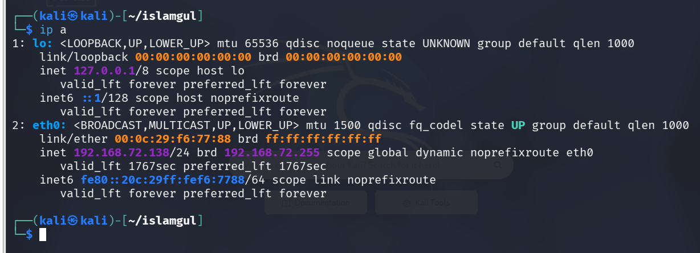

ip route 
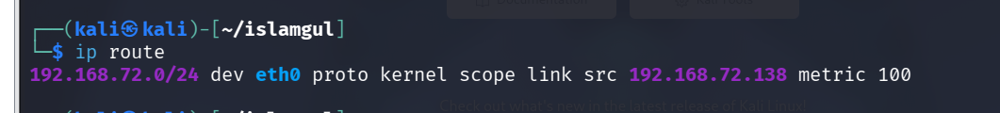


Step 4: External Connectivity Test**
ping -c 4 8.8.8.8
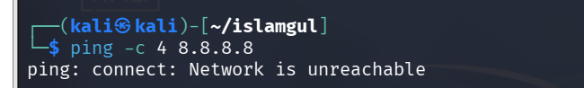


### Analysis
The ip address of the kali machine is 191.168.72..138 which is a private ip so the machine cannot connect over the network therefore it cannot ping the 8.8.8.8

---

## Task B2 — File Permission Manipulation

### Objective
Demonstrate proficiency in Unix permission models through both symbolic and octal notation, documenting before/after states.

### Procedure

**Step 1: Test File Creation**
```bash
mkdir permissions_lab && cd permissions_lab
echo "Permission analysis test file" > testfile.txt
ls -l testfile.txt
```
Baseline: `-rw-r--r--` (644) — owner read/write, group read, others read.

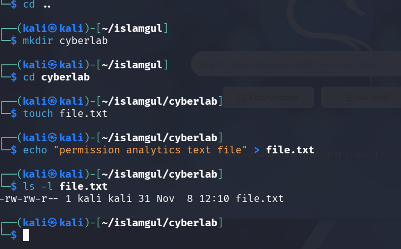

**Step 2: Symbolic Notation — Others Read Removal**
```bash
chmod o-r testfile.txt
ls -l testfile.txt
```
Result: `-rw-r-----` (640) — others access revoked.

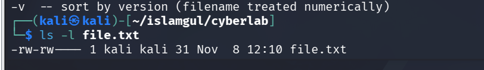

**Step 3: Symbolic Notation — Owner Execute Addition**
```bash
chmod u+x testfile.txt
ls -l testfile.txt
```
Result: `-rwxr-----` (740) — owner execution permission added.

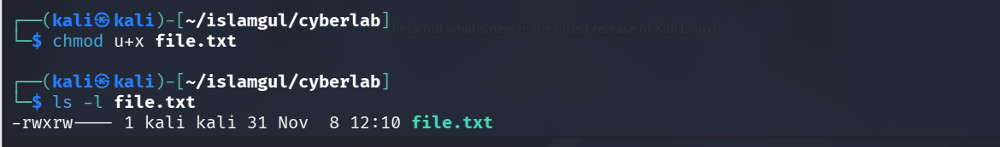

**Step 4: Octal Notation — Restricted Access (640)**
```bash
chmod 640 testfile.txt
ls -l testfile.txt
```
Result: `-rw-r-----` — owner read/write (6), group read-only (4), others none (0).
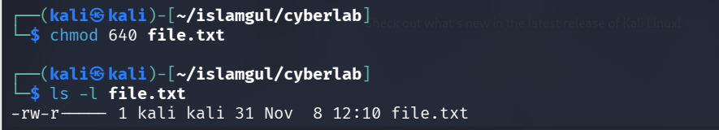

**Step 5: Octal Notation — Standard Executable (755)**
```bash
chmod 755 testfile.txt
ls -l testfile.txt
```
Result: `-rwxr-xr-x` — owner full control (7), group/others read+execute (5).

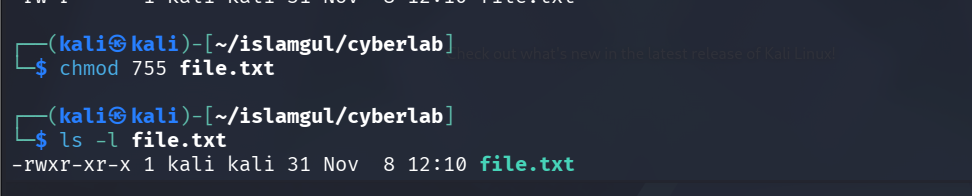

### Analysis
we can create folder through mkdir command and  then create a file inside it through touch command and then we have assign permission to the users people and others on two ways symbolic and octal notation.

## Task B3 — Caesar Cipher Cryptanalysis Tool

### Objective
Implement a brute-force decryption utility for Caesar cipher, demonstrating keyspace exhaustion vulnerabilities in classical cryptography.

### Mathematical Foundation
For ciphertext character `c` with alphabet position `p` (A=0…Z=25), decryption function:  
`plaintext = (p - key) mod 26`

### Implementation

```python
#!/usr/bin/env python3
"""Caesar cipher brute-force decryption utility."""

ciphertext = input("Enter Caesar-shifted text (UPPERCASE A-Z): ").upper()

for shift in range(1, 26):
    plaintext = ''.join(
        chr((ord(c) - 65 - shift) % 26 + 65) if c.isalpha() else c
        for c in ciphertext
    )
    print(f"shift {shift:2d}: {plaintext}")
```

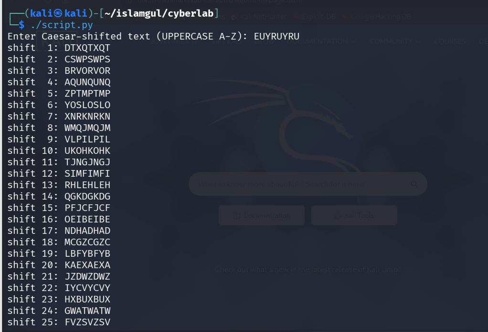

### Technical Analysis

| Component | Function | Cryptographic Rationale |
|-----------|----------|-------------------------|
| `ord(c) - 65` | ASCII-to-alphabet position conversion | Normalizes A-Z to 0-25 for modular arithmetic |
| `- shift` | Reverse transformation | Undoes encryption shift |
| `% 26` | Modular wraparound | Maintains alphabet bounds (Z→A) |
| `c.isalpha()` filter | Non-alphabetic preservation | Caesar operates on letters only; spaces/punctuation pass through |

### Execution Results

**Test Vector 1: Known Plaintext (Handout Example)**
```bash
python3 caesar_decoder.py
# Input: KDFNHU
# Expected: shift 3 produces HACKER — only intelligible result
```

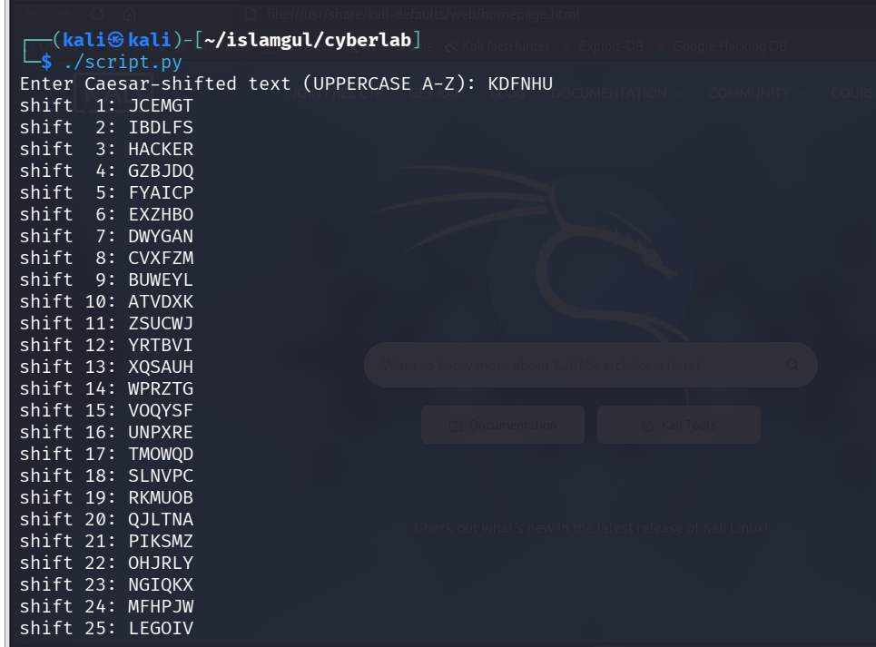

**Test Vector 2: Unknown Key Validation**
```bash
python3 caesar_decoder.py
# Input: ZHOFRPH
# Expected: shift 3 produces WELCOME — key recovered through pattern recognition
```

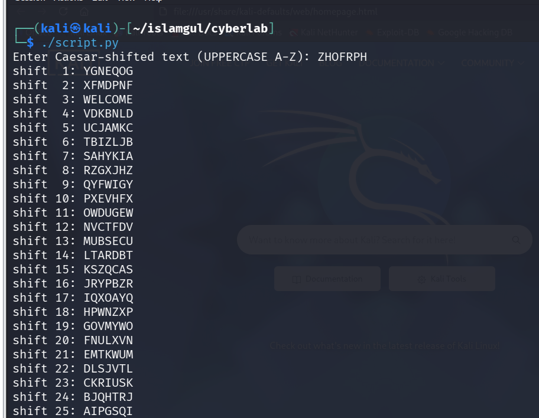

### Security Assessment
The Caesar cipher keyspace contains 25 elements, exhaustible in milliseconds computationally or through manual inspection. This illustrates Shannon's principle: security through obscurity fails against known-plaintext and brute-force attacks. Modern symmetric encryption (AES-256) operates with 2^256 keyspace, rendering exhaustion computationally infeasible.

---

## Task B4 — OpenSSL Symmetric Encryption Analysis

### Objective
Implement AES-256-CBC encryption with PBKDF2 key derivation, analyze binary structure through hexadecimal inspection, and evaluate forensic identification markers.

### Environment
```bash
openssl version
```
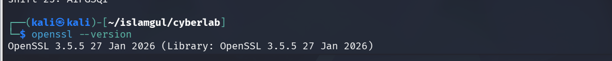

### Procedure

**Step 1: Test Data Preparation**
```bash
mkdir cyber && cd cyber
echo "my secret message" > secret.txt
```

**Step 2: AES-256-CBC Encryption**
```bash
openssl enc -aes-256-cbc -salt -pbkdf2 -in secret.txt -out secret.enc
```
Password entry via interactive prompt (preventing shell history exposure per forensic evidence handling principles).

| Parameter | Cryptographic Function |
|-----------|----------------------|
| `-aes-256-cbc` | Advanced Encryption Standard, 256-bit key, Cipher Block Chaining mode |
| `-salt` | Random 8-byte salt generation; ensures unique ciphertext per encryption event |
| `-pbkdf2` | Password-Based Key Derivation Function 2; replaces deprecated EVP_BytesToKey |

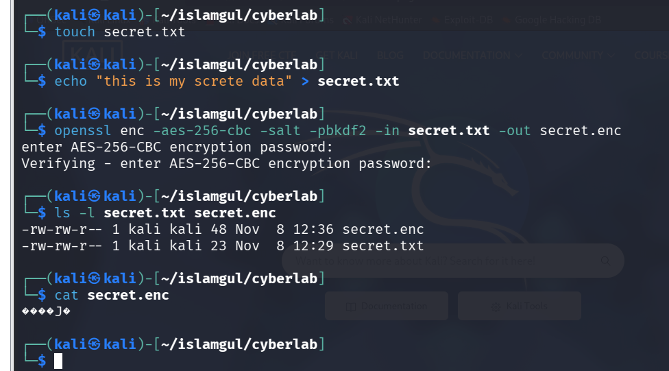
**Step 3: File Size Analysis**
```bash
ls -l secret.txt secret.enc
```
Observed: 18 bytes (plaintext) → 48 bytes (ciphertext)  
Composition: 8 bytes (`Salted__`) + 8 bytes (salt) + 32 bytes (2×16-byte AES blocks with PKCS#7 padding)


**Step 4: Binary Structure Inspection**
```bash
xxd -l 16 secret.enc
```
Output analysis:
- Bytes 0-7: `53 61 6c 74 65 64 5f 5f` → ASCII `Salted__` (OpenSSL magic header)
- Bytes 8-15: Random salt (instance-unique)
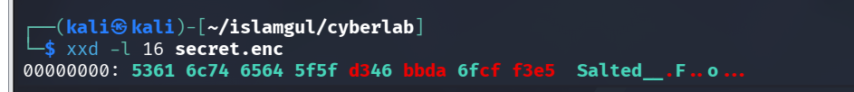

**Step 5: File Type Identification**
```bash
file secret.enc
```
Result: `openssl enc'd data with salted password` — positive identification without key material.

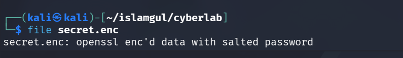

**Step 6: Decryption Verification**
```bash
openssl enc -d -aes-256-cbc -pbkdf2 -in secret.enc -out decrypt.txt
cat decrypt.txt
```
Round-trip integrity confirmed: original plaintext recovered.

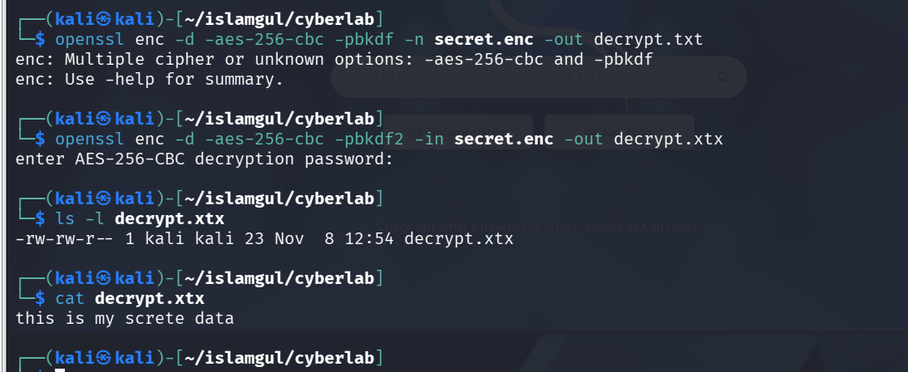

**Step 7: Salt Randomness Validation**
```bash
openssl enc -aes-256-cbc -salt -pbkdf2 -in secret.txt -out secret2.enc
xxd -l 16 secret2.enc
```
Observation: Identical `Salted__` magic; divergent salt bytes; completely different ciphertext. Same password, different cryptographic output.

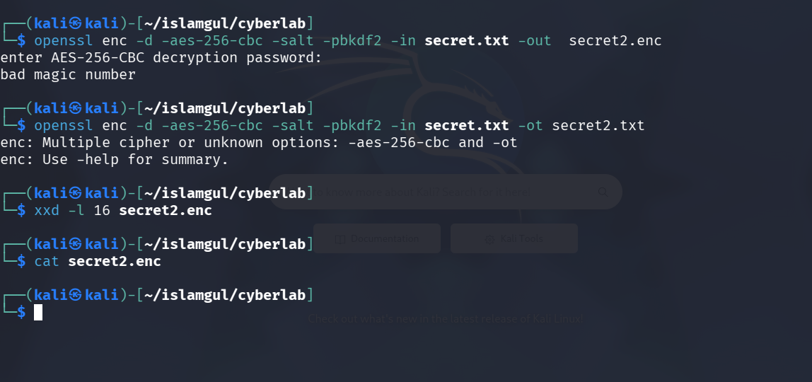

### Forensic Analysis: The `Salted__` Header

**Structural Composition**  
Offset 0-7: Literal ASCII `Salted__` (hex `53616c7465645f5f`)  
Offset 8-15: Random salt for PBKDF2 key derivation  
Offset 16+: AES-256-CBC ciphertext

**Security Function**  
The salt ensures identical passwords produce divergent ciphertexts and derived keys, defeating precomputed rainbow table attacks. The header is non-secret metadata enabling decryption: the salt is extracted and combined with the password to re-derive the encryption key.

**Forensic Significance**  
Unknown binary blobs can be fingerprinted pre-decryption: presence of `53616c7465645f5f` at offset 0 identifies OpenSSL `enc` output, revealing the attack vector (password guessing with extracted salt). This aligns with Day 1 §1.3: hashes are one-way; recovery requires candidate password testing, identical to NTLM/SAM cracking methodology (§11.5).

**Cryptographic Limitations**  
CBC mode lacks authentication: ciphertext manipulation produces silent corruption rather than integrity verification failures. Production environments require AEAD modes (AES-GCM); `openssl enc` does not support AEAD (fails with "AEAD ciphers not supported").

---

## Task B5 — Man-in-the-Middle Attack Case Study

### Selected Incident: Superfish Adware (Lenovo, 2014–2015)

### Incident Overview
Between September 2014 and February 2015, Lenovo pre-installed Superfish VisualDiscovery adware on consumer laptops. The software intercepted all HTTPS traffic by installing its own root certificate and performing TLS interception. This created a universal MITM capability on affected machines, exposing users to credential theft and session hijacking.

### Technical Mechanism
1. **Root Certificate Installation**: Superfish installed its own root CA certificate into the Windows trusted certificate store
2. **TLS Interception**: For every HTTPS connection, Superfish generated a fake certificate for the target site, signed with its own root
3. **Traffic Decryption**: The browser trusted these certificates because the Superfish root was in the trust store
4. **Ad Injection**: Superfish decrypted traffic, injected advertisements, and re-encrypted it to the real server

### Impact Quantification
- **Affected endpoints**: ~500,000+ laptops (Lenovo consumer lines)
- **Data compromised**: All HTTPS traffic visible to Superfish (banking, email, medical, corporate VPNs)
- **Financial impact**: Class-action settlement, FTC investigation, severe reputation damage
- **Duration**: ~5 months pre-installed; certificates persisted until manually removed

### Preventive Controls
| Control | Mechanism | Preventive Value |
|---------|-----------|------------------|
| Certificate Pinning | Pre-installed certificate fingerprints in applications | Rejects fraudulent certificates regardless of CA trust |
| HTTP Strict Transport Security | Forces HTTPS, prevents downgrade attacks | Eliminates SSL stripping vectors |
| Certificate Transparency | Public CT logs for all certificates | Enables detection of unauthorized certificates |
| User Education | Training to never bypass certificate warnings | Prevents click-through of MITM warnings |

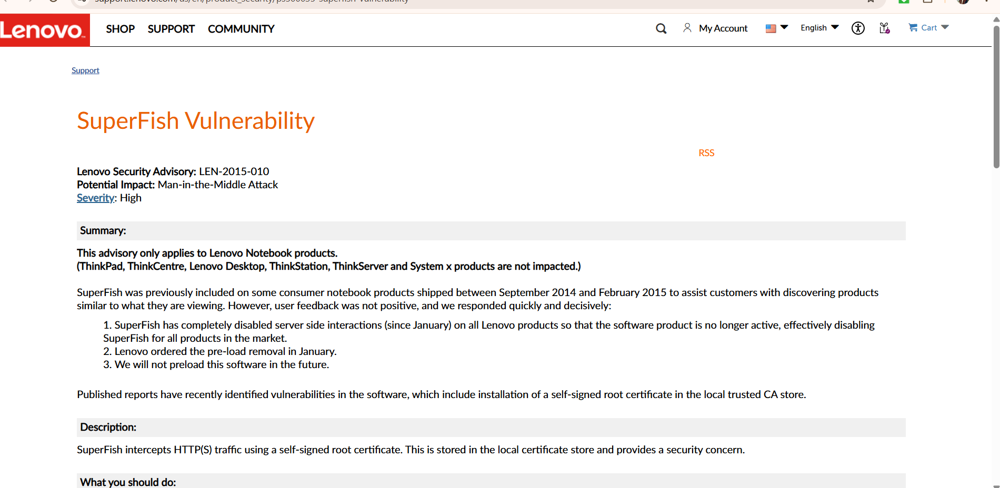

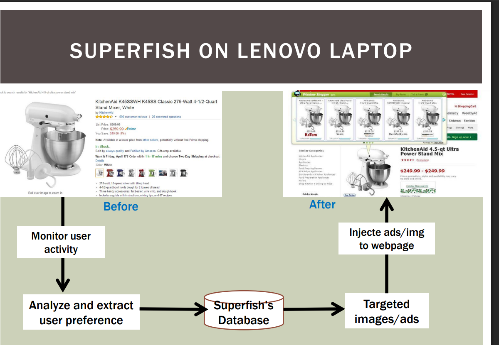

### Analysis
The Superfish incident demonstrates how trust model compromise enables universal MITM. The root certificate installation subverted the entire PKI system. Modern defenses like certificate transparency and HPKP (deprecated but conceptually important) aim to detect such compromises. The incident cost Lenovo millions and remains a cautionary tale about supply chain trust.

---

## Task B6 — Network Reconnaissance and Path Analysis

### Objective
Identify public IP addressing, classify network range, and analyze routing path to target infrastructure.

### Procedure

**Step 1: Public IP Identification**
```bash
curl ifconfig.me
```
Result:
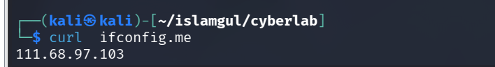

**Step 2: Address Classification**

| Class | First Octet | Default Mask | Allocation |
|-------|-------------|--------------|------------|
| A | 1–126 | 255.0.0.0 | Major ISPs, large enterprises |
| B | 128–191 | 255.255.0.0 | Regional providers |
| C | 192–223 | 255.255.255.0 | Small businesses, residential |

Analysis: IP 192.168.25,132— first octet [192] — Class c — private  addressing.

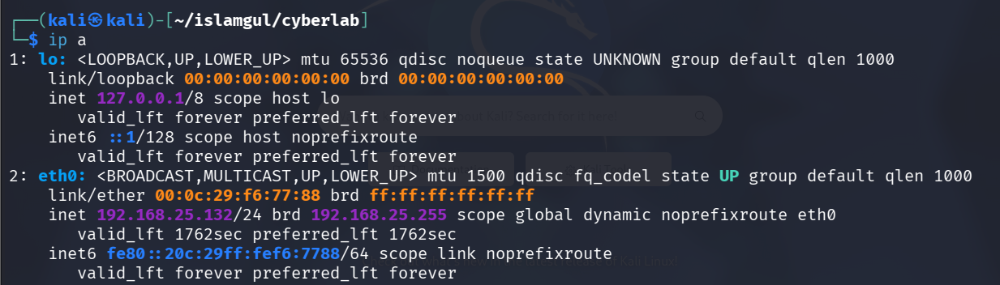

**Step 3: Traceroute Execution**
```bash
traceroute google.com
```
Captures hop-by-hop path with latency metrics.

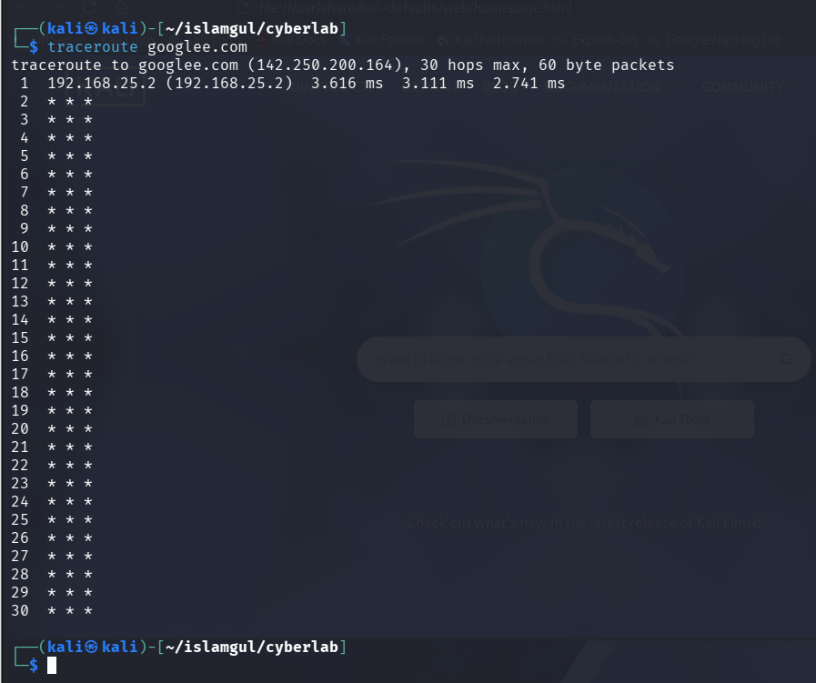

**Step 4: TTL-Based Distance Estimation**

TTL mechanics: Initial value (OS-dependent: Linux=64, Windows=128, Network devices=255) decremented by each router.

Calculation methodology:
```
Observed TTL: [N]
Estimated origin: [Linux/Windows]
Formula: Hops = Initial TTL - Observed TTL
Result: [X] hops
```

**Reliability Limitations:**  
TTL values are mutable—firewalls rewrite TTL, NAT modifications occur, tunnels obscure intermediate hops, asymmetric routing creates divergent paths. TTL analysis provides triage intelligence, not forensic proof.
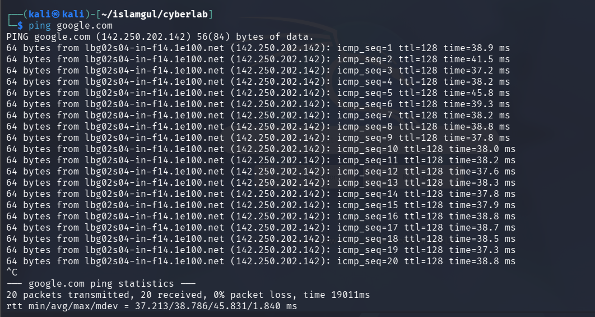

### Analysis
The destination IP (142.250.202.142) falls into Class B (first octet 142), reflecting a publicly routable commercial allocation for global infrastructure. A steady remaining time-to-live (ttl=128) points to an initial value of 128—common for Windows-based server responses—while the stable sub-40ms round-trip times indicate consistent routing path behavior. However, using terminal TTL values to precisely deduce total hop counts remains constrained because intermediate network devices can occasionally alter or obscure packet header decrement patterns.

---

# 13. Evidence Index

| Task | Evidence ID | Description | Capture Command |
|------|-------------|-------------|---------------|
| B1 | B1-1 | Network interface configuration | `ip a` |
| B1 | B1-2 | Routing table | `ip route` |
| B1 | B1-3 | Isolation verification | `ping -c 4 8.8.8.8` |
| B2 | B2-1 | File creation baseline | `ls -l testfile.txt` |
| B2 | B2-2 | Permission modification (symbolic) | `chmod o-r testfile.txt` |
| B2 | B2-3 | Execute permission addition | `chmod u+x testfile.txt` |
| B2 | B2-4 | Octal restriction (640) | `chmod 640 testfile.txt` |
| B2 | B2-5 | Standard executable (755) | `chmod 755 testfile.txt` |
| B3 | B3-1 | Implementation evidence | Script display |
| B3 | B3-2 | Known vector test | `python3 caesar_decoder.py` |
| B3 | B3-3 | Unknown key recovery | `python3 caesar_decoder.py` |
| B4 | B4-1 | OpenSSL version | `openssl version` |
| B4 | B4-2 | Encryption execution | `openssl enc -aes-256-cbc...` |
| B4 | B4-3 | Size differential | `ls -l secret.*` |
| B4 | B4-4 | Binary structure | `xxd -l 16 secret.enc` |
| B4 | B4-5 | File identification | `file secret.enc` |
| B4 | B4-6 | Decryption verification | `openssl enc -d... && cat decrypt.txt` |
| B4 | B4-7 | Salt uniqueness | Second encryption + `xxd` |
| B5 | B5-1 | Source citation | Research documentation |
| B5 | B5-2 | Technical diagram | MITM visualization |
| B6 | B6-1 | Public IP | `curl ifconfig.me` |
| B6 | B6-2 | IP classification | Analysis documentation |
| B6 | B6-3 | Traceroute | `traceroute google.com` |
| B6 | B6-4 | TTL calculation | `ping` + analysis |

**Total Evidence Items: 26**

---

# 14. References

## Primary Course Materials
- Khan, W. A. (2026). *DFCS Day 1 Student Handout*. Atomcamp.

## Malware Intelligence
- CISA. (2017). *WannaCry Ransomware Guidance*. Cybersecurity & Infrastructure Security Agency.
- Symantec. (2017). *Fireball Adware Analysis*. Security Response.
- Citizen Lab. (2018). *The Kingdom Came to Canada*. University of Toronto.
- Microsoft MSRC. (2022). *CVE-2022-21894*. Security Update Guide.

## Cryptographic Standards
- OpenSSL Project. (2026). *OpenSSL enc(1) Manual Page*.
- National Institute of Standards and Technology. (2001). *FIPS PUB 197: Advanced Encryption Standard*.

## Network Protocols
- Postel, J. (1981). *RFC 791: Internet Protocol*. IETF.
- Postel, J. (1981). *RFC 792: Internet Control Message Protocol*. IETF.

---

## Candidate Declaration

I declare that all commands documented herein were executed personally in my assigned Kali Linux virtual machine. All screenshots constitute original evidence captured from my environment. External research sources are cited appropriately.

**Signature:** Islam Gul  
**Date:** 27 October 2026
